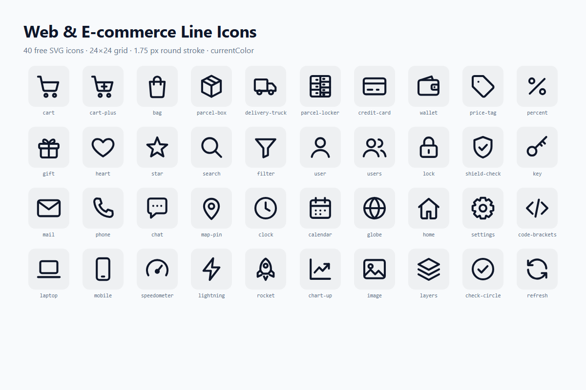

# Web & E-commerce Line Icons

40 free line icons for business websites and online stores: cart, parcel box, delivery truck, parcel locker, payment card, price tag, lock, shield, chat, map pin, speedometer, code brackets and more.



- 24 × 24 px grid, 1.75 px round stroke
- `stroke="currentColor"`, `fill="none"` – icons inherit your text colour
- Individual SVG files, an SVG sprite and PNG exports (64 px and 256 px)

## Download

[ks-web-icons.zip](ks-web-icons.zip) – SVG, sprite, PNG 64/256, previews, README and licence.

## Usage

```html
<svg width="24" height="24" aria-hidden="true">
  <use href="sprite.svg#ks-cart"></use>
</svg>
```

Or paste any file from `svg/` inline and style it with CSS `color`.

## Icons

cart, cart-plus, bag, parcel-box, delivery-truck, parcel-locker, credit-card, wallet, price-tag, percent, gift, heart, star, search, filter, user, users, lock, shield-check, key, mail, phone, chat, map-pin, clock, calendar, globe, home, settings, code-brackets, laptop, mobile, speedometer, lightning, rocket, chart-up, image, layers, check-circle, refresh

## License

MIT – free for personal and commercial use. Attribution is appreciated but not required.

Made by Justas Arbatauskis, [KokybiskaSvetaine.lt](https://kokybiskasvetaine.lt/).
